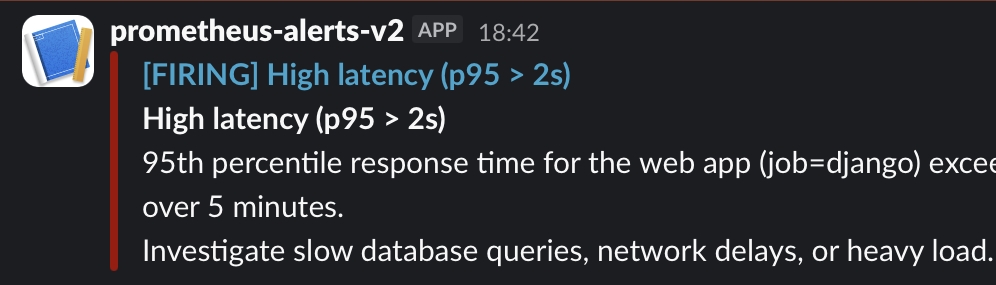
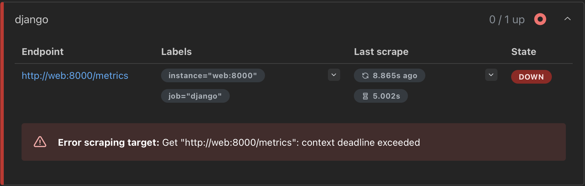
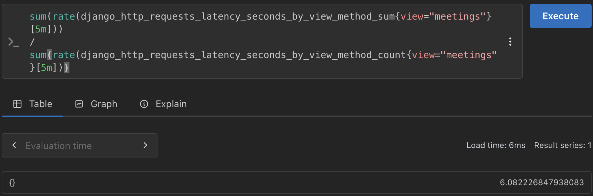

# Backend Observability Platform

A Dockerized Django backend project built to explore **application observability, database monitoring, caching, background task processing, metrics, dashboards, and alerting** using Prometheus, Grafana, and Alertmanager.

The project demonstrates how backend services can be monitored across multiple layers, and how operational problems are detected and routed to a live notification channel before they're noticed by watching a dashboard.

## Architecture

```text
                         ┌──────────────────┐
                         │      Client      │
                         │ Browser / API    │
                         └────────┬─────────┘
                                  │
                                  ▼
                         ┌──────────────────┐
                         │  Django / WSGI   │
                         │   Application    │
                         └───────┬──────────┘
                                 │
                 ┌───────────────┼────────────────┐
                 │               │                │
                 ▼               ▼                ▼
          ┌────────────┐  ┌────────────┐  ┌────────────┐
          │ PostgreSQL │  │   Redis    │  │   Celery   │
          │  Database  │  │Cache/Broker│  │  Worker /  │
          │            │  │            │  │  Beat      │
          └──────┬─────┘  └──────┬─────┘  └──────┬─────┘
                 │               │               │
                 │ metrics       │ metrics       │ metrics
                 ▼               ▼               ▼
          ┌────────────┐  ┌────────────┐  ┌────────────┐
          │ PostgreSQL │  │   Redis    │  │   Celery   │
          │  Exporter  │  │  Exporter  │  │  Exporter  │
          └──────┬─────┘  └──────┬─────┘  └──────┬─────┘
                 │               │               │
     node_exporter (host/infra)  │               │
                 │               │               │
                 └───────┬───────┴───────┬───────┘
                         │               │
                         ▼               ▼
                  ┌──────────────────────────┐
                  │        Prometheus        │
                  │      Metrics Store        │
                  └────────────┬──────────────┘
                                │
                    ┌───────────┴────────────┐
                    ▼                         ▼
             ┌──────────────┐        ┌──────────────┐
             │   Grafana    │        │ Alertmanager │
             │  Dashboards  │        │ Alert Routing│
             └──────────────┘        └──────┬───────┘
                                             │
                                             ▼
                                          Slack
```

**Key distinction:** alerting in this project is handled by **Prometheus alert rules → Alertmanager → Slack**, not Grafana's own alerting engine. Grafana is used purely for visualization; Alertmanager owns evaluation, grouping, and routing of alerts.

## Technology Stack

* Python, Django, Django REST Framework
* PostgreSQL + postgres_exporter
* Redis + redis_exporter
* Celery, Celery Beat, Flower + celery_exporter
* Prometheus (metrics store + alert rule evaluation)
* Alertmanager (alert routing + Slack delivery)
* Grafana (dashboards)
* node_exporter (host/infrastructure metrics)
* Docker / Docker Compose
* Slack (alert notifications)

## Observability Pipeline

```text
Application / Database / Redis / Celery / Host
             │
             ▼
          Exporters
             │
             ▼
        Prometheus  ──── alert rule evaluation
             │                    │
       PromQL queries             ▼
             │              Alertmanager
             ▼                    │
          Grafana                 ▼
       (dashboards)             Slack
```

### Prometheus

Prometheus periodically scrapes metrics exposed by the application and each exporter, and separately evaluates alert rules defined in `monitoring/alert_rules.yml` against that data.

Examples of tracked metrics:

* HTTP request rate, latency, and error rate
* Database connections, transaction rate, disk I/O
* Redis memory usage, connected clients, cache hit/miss rate
* Celery exporter and worker availability
* Host CPU, memory, disk, and network (via node_exporter)

### Grafana

Grafana uses Prometheus as its data source and provides dashboards for visualizing system behaviour, organized by system layer. Grafana does not own alert evaluation in this setup — that responsibility belongs to Prometheus + Alertmanager.

## Dashboards

### 1. System / Infrastructure
CPU, memory, disk, load average, and network traffic — powered by node_exporter. Used to determine whether an application-level problem is actually caused by resource pressure underneath the application.

### 2. Application Performance
Request rate (split by method), responses by status code, p50/p95/p99/p99.9 latency (overall and per view), and error rate for the Django app.

### 3. Database Observability
Active connections, process CPU/RSS, disk I/O, and query behaviour — sourced from postgres_exporter.

### 4. Redis / Cache Observability
Memory usage, connected clients, and cache miss rate — sourced from redis_exporter. Redis also serves as the Celery message broker.

### 5. Celery Dashboard
Task throughput and worker/exporter availability via celery_exporter and Flower.

## Alerting

Alert rules live in `monitoring/alert_rules.yml`, grouped by category:

* **Availability** — service-down detection (app, exporters, dependencies)
* **Performance** — high CPU, low memory, disk nearly full
* **Latency & Errors** — elevated 5xx rate, p95 latency above threshold

```text
Metric crosses threshold (Prometheus rule)
             │
             ▼
       PENDING → FIRING
             │
             ▼
        Alertmanager
             │
             ▼
           Slack
```

Alerts route through Alertmanager with `send_resolved: true`, so the Slack channel shows both the incident and its resolution — not just the initial failure.

## Docker Services

```text
web                  — Django application
db                   — PostgreSQL
redis                — Redis (cache + Celery broker)
celery               — Celery worker
celery-beat          — Celery scheduler
celery-flower        — Celery monitoring UI
prometheus           — metrics store + alert evaluation
alertmanager         — alert routing to Slack
grafana              — dashboards
node-exporter        — host metrics
postgres_exporter    — PostgreSQL metrics
redis-exporter       — Redis metrics
celery-exporter      — Celery metrics
```

Services communicate over the Docker network using their service names. Selected ports are mapped to the host for local access.

| Service           |  Port |
| ------------------ | ----: |
| Django              |  8000 |
| PostgreSQL          |  5432 |
| Redis               |  6379 |
| Prometheus          |  9090 |
| Grafana             |  3000 |
| Alertmanager        |  9093 |
| Flower              |  5555 |
| node_exporter       |  9100 |
| postgres_exporter   |  9187 |
| redis_exporter      |  9121 |
| celery_exporter     |  9808 |

## Project Structure

```text
project1/
│
├── observability/              # Core Django app
│   ├── models.py
│   ├── views.py
│   ├── serializers.py
│   ├── tasks.py
│   ├── urls.py
│   └── migrations/
│
├── observability_project/      # Django project config
│   ├── settings.py
│   ├── urls.py
│   ├── wsgi.py
│   ├── asgi.py
│   └── celery.py
│
├── monitoring/
│   ├── prometheus.yml
│   ├── alert_rules.yml
│   └── alertmanager.yml
│
├── grafana_dashboards/         # Exported Grafana dashboard JSON
│
├── tools/
│   └── simulate_traffic.py     # Traffic generator for testing the pipeline
│
├── docker-compose.yml
├── Dockerfile
├── entrypoint.sh
├── redis.conf
├── postgres_queries.yml        # Custom queries for postgres_exporter
├── requirements.txt
├── .env.sample
├── .gitignore
└── README.md
```

## Configuration

Environment-specific configuration is kept outside the repository.

```bash
cp .env.sample .env
```

Do **not** commit the actual `.env` file. Sensitive values — database passwords, Django secret key, Grafana credentials, the Slack webhook URL — stay outside source control (`.env` and other secret-bearing files are excluded via `.gitignore`).

## Running the Project

```bash
# Build and start all services
docker-compose up -d --build

# Check status
docker-compose ps

# View logs (all services, or a specific one)
docker-compose logs -f
docker-compose logs -f web

# Stop everything
docker-compose down
```

## Accessing the Services

| Service | URL |
|---|---|
| Django app | http://localhost:8000 |
| Prometheus | http://localhost:9090 |
| Grafana | http://localhost:3000 (default admin/admin) |
| Alertmanager | http://localhost:9093 |
| Flower (Celery) | http://localhost:5555 |

In Grafana, add Prometheus (`http://prometheus:9090`) as a data source, then import the dashboards from `grafana_dashboards/`. Grafana keeps its dashboards in its own data volume; the JSON files in the repo are exported copies.

## Metrics Verification

```text
Exporter / Application
        │
        │ /metrics
        ▼
    Prometheus
```

Scrape target health can be checked directly at `localhost:9090/targets` — every target should report state `UP`.

## Traffic Simulation

```bash
docker compose build simulator      # rebuild after changing tools/simulate_traffic.py
docker compose run --rm simulator   # 10 concurrent clients for 7 minutes
```

The simulator runs in its own container (under the `tools` profile, so a normal `docker compose up` skips it). It sends weighted traffic to `/observability/meetings/`, `/observability/messages/` and `/health/`, plus light background queries to PostgreSQL. The meetings view includes a deliberate 2-second delay so the latency panels and the `High95thLatency` alert have something real to catch.

The goal isn't to benchmark maximum capacity — it's to generate enough realistic load to observe how request rate, latency, error rate, database activity, and Redis activity change, and to confirm dashboards and alert rules respond to that activity in real time.

## End-to-End Alert Test

This is the core validation that the observability pipeline actually works, not just that it's configured:

```bash
docker stop celery-exporter     # simulate an outage
# → localhost:9090/targets shows the target as DOWN
# → localhost:9090/alerts shows CeleryExporterDown go PENDING → FIRING
# → localhost:9093 shows the alert routed in Alertmanager
# → Slack receives the firing notification

docker start celery-exporter    # resolve the outage
# → Slack receives a "resolved" notification
```

## Findings

Load-testing the stack surfaced three real problems. Each one was measured, explained, fixed and measured again.

### 1. Two alert rules could never fire

`HighAppErrorRate` and `High95thLatency` queried `http_requests_total` and `http_request_duration_seconds_bucket` under `job="web"`. None of those exist in this project: the scrape job is `django`, and django-prometheus names its metrics `django_http_...`. The rules evaluated without errors, so nothing looked wrong, but they matched no data and could never fire.

**Fix:** rewrote both rules to use `django_http_responses_total_by_status_total` and `django_http_requests_latency_seconds_by_view_method_bucket` with `job="django"`, and validated the file with `promtool check rules` (11 rules found) before reloading Prometheus.

**Result:** under load, `High95thLatency` went Pending → Firing and reached Slack.



### 2. Overload made the monitoring blind

With 40 concurrent clients, the app's single gunicorn process (1 worker × 16 threads) was saturated by requests to the 2-second meetings endpoint. Prometheus's own request to `/metrics` waited in the same queue and hit the 5-second scrape timeout (`context deadline exceeded`), so the target showed DOWN and `AppDown` fired.

The latency alert stayed silent, because when scrapes fail, Prometheus can't see latency either. Only the "is it reachable" alert caught the problem. `/metrics` also stayed unresponsive after the load stopped, while other endpoints kept answering; restarting the `web` container restored it (next scrape: 12 ms). The exact cause of that lingering hang wasn't confirmed.



**Lessons:** pair latency alerts with reachability alerts; size the load test to the server's capacity (10 clients kept the target UP the whole time); and consider serving metrics separately from application traffic (see Future Improvements).

### 3. An unpaginated list endpoint got slower as data grew

During the 10-client test, the meetings endpoint averaged far more than its deliberate 2-second delay, and p99 sat in the 10–25 second bucket. The list endpoints had no pagination, so every GET serialized the whole table: 4,061 meetings at the time.

**Fix:** enabled DRF page-number pagination with `PAGE_SIZE = 50` and re-ran the same test.

| Meetings endpoint | Before | After |
|---|---|---|
| Rows returned per GET | 4,061 (all) | 50 |
| Average latency | **6.08 s** | **2.02 s** |

What remains after the fix is the 2-second delay plus about 20 ms of real work. The averages were measured exactly with the histogram's sum divided by its count, rather than estimated from buckets:

```promql
sum(rate(django_http_requests_latency_seconds_by_view_method_sum{view="meetings"}[5m]))
/
sum(rate(django_http_requests_latency_seconds_by_view_method_count{view="meetings"}[5m]))
```

| Before | After |
|---|---|
|  |  |

## Debugging Approach

```text
Application appears slow
          │
          ▼
Check request rate / latency / errors
          │
          ▼
Is the application itself the bottleneck?
          │
      ┌───┴───┐
      │       │
     Yes      No
      │       │
      ▼       ▼
Application   Check dependencies
metrics       ├── PostgreSQL
              ├── Redis
              ├── Celery
              └── System resources (node_exporter)
```

A layer-by-layer approach that narrows down the source of a performance problem instead of assuming the Django application is always responsible.

## What This Project Demonstrates

* Designing and containerizing a Django backend with a multi-service Docker Compose stack
* Docker networking and inter-service communication
* PostgreSQL and Redis integration
* Celery background processing (worker, beat, and monitoring)
* Prometheus metrics collection and PromQL
* Exporter-based monitoring across app, database, cache, and host layers
* Grafana dashboard design
* Prometheus alert rule authoring and the separation between metric evaluation (Prometheus) and alert routing (Alertmanager)
* Slack notification integration, including resolved-state notifications
* Controlled traffic simulation to validate the pipeline under load
* Systematic, layer-by-layer performance investigation

## Key Learning

> A backend system should not only process requests — it should provide enough visibility to understand how it behaves, and enough automation to surface problems before someone has to go looking for them.

Metrics provide the raw measurements, Prometheus stores and evaluates them, Grafana makes them understandable, and Alertmanager turns important changes into actionable notifications.

## Future Improvements

* Add concrete Celery-specific alert rules (task failure rate, queue backlog) — currently a placeholder rule group
* Load-test `HighAppErrorRate` with a real error-producing scenario (`High95thLatency` has been verified under load — see Findings)
* Serve `/metrics` separately from application traffic (django-prometheus `PROMETHEUS_METRICS_EXPORT_PORT`) so scrapes can't queue behind slow requests
* Run more gunicorn worker processes and tune latency buckets closer to the latency targets
* Deploy the stack to a cloud environment (AWS/GCP)
* Reverse proxy + HTTPS/TLS
* Distributed tracing (OpenTelemetry)
* Centralized logging
* CI/CD automation

## Disclaimer

This is a personal learning project built to demonstrate practical backend, containerization, monitoring, and observability concepts. Traffic levels and infrastructure are intentionally limited to a development/personal environment and should not be interpreted as production capacity benchmarks.
